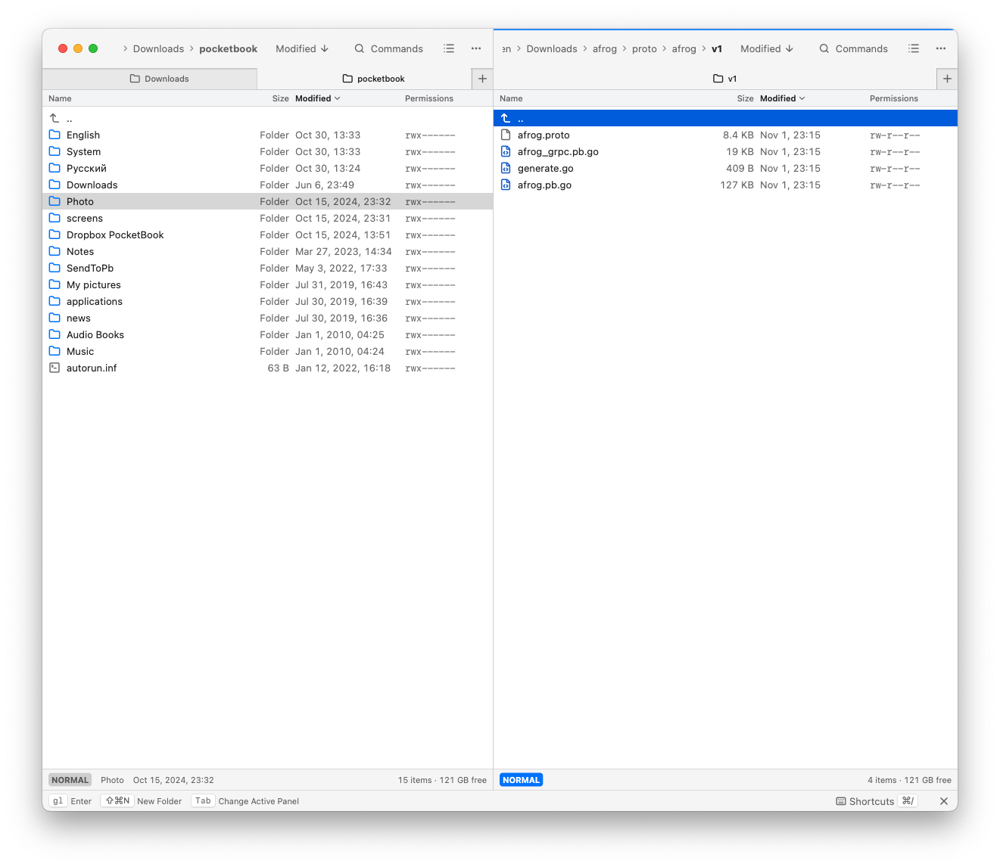

# Ferryx

A desktop file manager built for the keyboard, with two panels and tabs.
Browse local folders, archives and servers; preview documents; run file
operations in the background; keep a terminal beside your files.

For **macOS, Windows and Linux**, with an **English or Russian** interface,
light and dark themes, and platform-specific controls.

[Get started](#get-started) · [Panels](#panels-and-navigation) ·
[Files](#file-operations) · [Archives](#archives) · [Preview](#preview) ·
[Terminal](#terminal) · [Servers](#servers) ·
[Keyboard and Vim](#keyboard-and-vim) · [Settings](#settings)

## Get started

1. Open a folder in each panel. **Tab** switches between them.
2. Mark files, then use **F5** to copy or **F6** to move them to the other panel.
   With nothing marked, the operation uses the current file.
3. Press **Space** to preview a file, or **i** in Vim mode.
4. Use **Commands** in the panel header to find an action and **Shortcuts**
   below the panels to see its keys.

The cursor and marked selection are separate: arrows move the cursor without
changing marks. **Insert** (or **Option+Space** on macOS) marks a file and
moves down. In Vim mode, **Space marks files** instead of opening Preview.

Shortcuts below use macOS defaults unless a Windows/Linux alternative is
shown. Your current bindings are always available in **Settings → Hotkeys**.

## Panels and navigation

Each panel keeps its own tabs, history, sorting and view mode. Panels sit
beside each other in a wide window and stack in a tall one; **⌥⌘P** or
Settings → Panels fixes the arrangement you prefer.

An accent outline identifies the area receiving keyboard input: a file
panel, the terminal or preview. It follows focus after a click or Tab;
opening a menu keeps the last area indicated. At the top outer corners,
the outline follows the window's curve; the junction between panels stays straight.
Tabs show selection with their normal platform colors, without a blue underline.

Drag the divider to resize. Hovering or dragging shows both percentages.
Double-click it, click **Equal panels**, or use **View → Make Panels Equal**
to restore **50/50**. The split is remembered.

Tabs, places, favorites and views

| Task | macOS default |
|---|---|
| New tab | ⌘T |
| Next / previous tab | ⌃Tab / ⌃⇧Tab; also ⇧⌘] / ⇧⌘[ |
| Swap panels | ⌘U |
| Show the current folder in the other panel | ⌥⌘U |
| Show one panel | ⇧⌘P |
| Resize with the keyboard | `⌥⌘\` |
| Go To pop-up | F1 / F2 |
| Parent folders / history / favorites / volumes | ⌘1 / ⌘2 / ⌘3 / ⌘4 |
| Go to a typed path | ⇧⌘G |
| Jump to a frequent folder | ⌘G |

In keyboard-resize mode, arrows move the divider, Shift+arrows take larger
steps, **0** restores equal panels, Return keeps the size and Esc restores
the previous split. When stacked, the left panel is the upper one.

Jump to Folder ranks visited places by frequency and recency. Type parts of
a path, then open it in the active panel, a new tab (⌘Return) or the other
panel (⌥Return).

**⌘B** adds a folder to favorites. Open **Manage Favorites**, select an entry
and click **Remove** to remove it; its row menu also renames and reorders.
Adding the same folder again keeps the existing entry.

Brief view shows names in columns; List shows a metadata table. Five view
presets on ⌃1–⌃5 are editable in Settings. Sort by name, extension, size or
file times, with folders-first and natural/case-sensitive ordering choices.
The header shows the active field and direction.

Typing starts quick search in normal mode; Vim uses `/`. Search can be
fuzzy, prefix-based or anywhere in the name, optionally hiding non-matches.
**Find Files** (⌘F) searches local folders by mask, regular expression,
contents and size. Results arrive progressively; macOS can use Spotlight.

**Flat view** (⌥⌘B, Vim `zf` / `:flat`) lists files below a folder together
with their relative paths. It works in local folders and read-only archives.
Deep changes by other programs may require Refresh (⌘R).

## File operations

Copy and move jobs run in the background with progress, pause/stop controls
and conflict questions. Their dialogs let you change the destination.

Deleting from a file panel starts with a **5-second countdown** in that
panel. Files stay in place until it ends. **Cancel**, or **Esc** while a
file list has focus, cancels the whole pending batch. The card stays with
its source panel when focus changes; changing tabs or marks does not
change the captured targets. Closing the window cancels pending batches.
Permanent/server deletion and the optional Trash confirmation still ask
first; the countdown follows confirmation. Once work starts, **Stop**
stops further processing; local Trash operations can be undone with ⌘Z.

| Tool | Purpose |
|---|---|
| Copy As / Move As | Choose a destination and a new name |
| New Folder | Create a folder, including a nested path |
| Duplicate and links | Duplicate local files; create symbolic/hard links |
| Batch Rename | Rename using patterns, dates, counters and search/replace, with a live preview |
| Rename in Editor | Edit local names in a built-in multiline dialog |
| File Attributes | Change permissions and modified/accessed times, optionally recursively |
| Compare Folders | Compare current listings and mark missing/newer items |
| Synchronize Folders | Review recursive one-way or two-way changes between local trees |
| Checksums | Calculate, look up, save or verify SHA-256, SHA-1, MD5 and BLAKE3 |
| Find Duplicates | Group identical local files and choose which copies to trash |

**Undo / Redo** (⌘Z / ⇧⌘Z) covers supported local changes for the current
session. It cannot restore **overwritten contents**, **permanent deletion**
or **server operations**.

Selection, renaming, the Shelf and Undo details

- Shift with movement selects a range. ⌘A marks all, ⌥⌘A clears marks and
  ⌃⌘A inverts them. Select by Mask (⌘=) accepts masks or regular expressions.
- Control+Space toggles a mark without moving. The parent row (`..`) is
  never an operation target.
- The delete dialog initially selects Trash; permanent deletion is a
  separate choice.
- The Shelf collects local files from several folders. Add with ⌥⌘S,
  show with ⌃⌘S, then copy/move the collected items into one destination.

Batch Rename patterns include name/path components (`[N]`, `[E]`, `[A]`,
`[P]`, `[G]`), substrings (`[N2-4]`, `[N-5,3]`), dates (`[d]`, `[Y]`,
`[M]`, `[D]`, `[t]`), counters (`[C5+5/2:3]`) and case conversion
(`[U]`, `[L]`, `[F]`, `[n]`). Rename in Editor validates empty, invalid,
duplicate or occupied names and supports name swaps.

File Attributes supports owner/group changes on Unix, file flags on macOS
and the read-only flag on Windows. macOS Finder tags appear beside file names;
⌃⌘T edits common/mixed tags and can create new names and colors.

Configure an external editor in **Settings → Editors** before using F4.
Editors/tools launch through desktop integration; the stored "in terminal"
flag does not currently route them through Ferryx's terminal.

Drag local files between panels, onto folder rows or to/from other apps.
Same-volume drops move; cross-volume drops copy. macOS Option forces copy
and Command forces move. Windows modifiers are not reported by the drag
plugin, so the volume rule applies. Archive members drag within Ferryx only.

Undo retains the last **100 steps in memory**. Created items go to Trash,
moved items move back and trashed items are restored. A preflight check
reports missing items, metadata changes and conflicting paths. Items Ferryx
trashes on macOS do not have Finder Put Back.

## Archives

Open supported archives as **read-only folders**, or create/extract them
with the built-in engine and installed programs.

**Compress:** ⌃⌘C on macOS, F9 on Windows/Linux, or Vim `zc`.
**Extract To:** ⌃⌘E on macOS, Alt+F9 on Windows/Linux, or Vim `zx`.

The dialogs offer format, name, engine and destination choices; the
extension follows the format. Engine/format choices are remembered.
**Settings → Archivers** detects programs, enables/disables them, adds
manual executable profiles and configures each program.

Formats, program settings and passwords

Built-in browsing covers ZIP-family archives, TAR with/without gzip, bzip2,
xz or zstd, 7z, RAR, ISO (Joliet/Rock Ridge), and single-file gzip/bzip2/xz/zstd
streams. Return opens a supported archive; ⌘↓ also checks file signatures.
F5 extracts selected members. Opening a member externally uses a temporary
copy; editing it does not update the archive. Multi-volume RAR browsing lists
the first volume's members only.

| Installed program | Creation in Ferryx |
|---|---|
| 7-Zip (`7zz`, `7z`, `7za`) | 7z, ZIP |
| TAR (`tar`, `bsdtar`) | TAR, TAR.GZ, TAR.BZ2, TAR.XZ, TAR.ZST |
| ZIP / UnZip | ZIP creation through `zip`; `unzip` extracts |
| RAR / UnRAR | RAR creation through `rar`; `unrar` extracts |
| The Unarchiver (`unar`) | Extraction only |
| gzip / pigz | GZ, TAR.GZ |
| bzip2 / pbzip2 | BZ2, TAR.BZ2 |
| xz | XZ, TAR.XZ |
| zstd | ZST, TAR.ZST |
| LZ4 | LZ4, TAR.LZ4 |

Formats depend on the installed program/version. Extra extractors do not
automatically extend built-in archive browsing; use Extract To for them.

Automatic selection uses built-in ZIP and the built-in reader where
available. Compressed TAR creation prefers a dedicated compressor when found.
One regular file can use a plain compression stream; folders, symlinks and
multiple items use a container. Sources are kept.

Each program's settings button offers supported compression levels, threads,
solid mode and **one additional argument per line**, without shell quoting.
Ferryx accepts supported compression/format arguments and supplies paths,
passwords and operation switches itself. Reset selects program defaults;
Save applies them. Settings are per executable and are not imported from
Keka, WinRAR or other graphical applications. Solid mode applies to 7z/RAR;
BSD tar's thread setting applies to TAR + zstd.

Built-in ZIP supports an optional AES-256 password. External password entry
is supported for 7-Zip. ZIP creation with 7-Zip and a non-ASCII password
switches to built-in ZIP with an explanation. Opened ZIP/7z/RAR passwords
are remembered for the session, not saved in program settings.

Jobs support cancellation, conflict handling and Undo. External work can show
an activity bar when its total is unknown. On Unix, pause suspends the worker;
on Windows, the program may keep preparing output while publication waits.

Vim examples: `:pack 7z`, `:pack tar.gz`, `:pack zst`,
`:unpack ~/Downloads`, `:archivers`. `:compress` aliases `:pack`,
`:zip` selects ZIP, and `:extract` aliases `:unpack`.

## Preview

**Space** in normal mode, **i** in Vim mode or **⇧⌘Y** opens preview beside
the file list. **F3** opens the full-window viewer. Use the placement button
to switch without reopening the document; **Tab** moves between files and
preview, and **Esc** closes it. The covered panel is restored on close.
The bottom shortcut strip stays in place when focus moves between files
and preview, showing the keys for the active area.

| Content | Supported formats |
|---|---|
| Text and hex | TXT, LOG and other UTF-8 text; windowed reads, Find and Go to Offset |
| Code and configuration | Syntax coloring for JSON, YAML, TOML/INI, XML, Dart, Rust, JavaScript/TypeScript, Python, Shell, C/C++, Java, Kotlin, Go, Swift, SQL and more |
| Tables | CSV (comma or semicolon) and TSV; quoted fields, row/column labels and selectable cells |
| Markdown | `.md`, `.markdown`, `.mdown`, `.mkd`, `.mkdn`; headings, lists, tables, task lists and code |
| Formatted text | HTML/HTM/XHTML, RTF, AsciiDoc (`.adoc`, `.asciidoc`) and reStructuredText (`.rst`, `.rest`) |
| Office documents | DOCX, XLSX, PPTX and legacy DOC, XLS, PPT; supported template and macro-enabled variants |
| Images | Whole-file preview, limited to 64 MiB |
| Reflowable books | EPUB, FB2 (also `.fbz` / `.fb2.zip`), MOBI 6, AZW3/KF8 |
| Fixed pages | PDF, CBZ, self-contained DjVu (`.djvu` / `.djv`) |

On macOS, **⌘Y opens system Quick Look**, separately from built-in Preview.

Office files open directly in built-in Preview, including in the neighboring
pane. No office application needs to be installed. Preview shows document text,
tables, worksheet sections, slide content and supported embedded raster images;
it is read-only and does not reproduce every aspect of the original page or
slide layout. Tables have visible cell borders and padding. Wide tables scroll
horizontally instead of squeezing every column into the pane; column widths
also follow the preview font size. Password-protected Office files and
XLSB/OpenDocument formats are not supported by this preview.

Reading controls and format limits

Code and configuration open in **Text**, with syntax coloring, Find,
wrapping and Go to Offset. Coloring applies to files up to 256 KiB;
larger files remain readable with windowed Text/Hex reads.

Markdown, tables and formatted text open in **Preview**. Use **Text** or
**Hex** to inspect the original file; Find and Go to Offset work on that
source. Preview type size follows Settings → Viewer → Font size.
Text mode uses compact line spacing (1.35 times the font size).
CSV/TSV keep values as text, including leading zeros, and do not assume
the first row is a header. Long cell contents are available on hover and
keyboard focus.

Formatted preview is limited to 512 KiB; Office source files to 32 MiB.
Office parsing also bounds decompressed data and memory. Converted Office
content may use up to 32 MiB including embedded images, with 20,000 elements
for rendering. Tables also have limits of 5,000 rows, 64 columns, 50,000 cells
and 16,384 characters per cell. A file that
exceeds a limit offers **Open Text** instead of showing a partial table.

HTML, AsciiDoc and reStructuredText show document content using the app's
typography. Scripts, forms, embedded media and external resources are not
loaded. AsciiDoc includes are disabled; Sphinx extensions are not supported.
RTF shows text, paragraphs and basic emphasis; embedded pictures, objects
and original page layout are not reproduced. Markdown supports GFM;
inline HTML and MDX are not rendered.

Markdown and HTML-based previews support selectable text and relative
raster images from the same filesystem, archive or server. Each image is
limited to 8 MiB encoded and 2048 pixels per side when decoded; external
and absolute image references are not loaded. Links show a selectable,
copyable target, as in book previews; HTML fragment links jump within
the document.

Books have A− / A+ controls and a reset to 15, with sizes from 10 to 32.
Book size is remembered separately from text/hex size and is available in
Settings → Viewer. ⌘− / ⌘+ / ⌘0 changes/resets book type size or zooms/fits
fixed pages; Windows/Linux use Ctrl instead of Command.

Page navigation, contents where available, zoom and Go to Page support
fixed-page reading. Text/hex use ⌘F for Find and ⌘L for Go to Offset;
their actions menu keeps controls available in narrow windows.

- EPUB/KF8 require horizontal reflowable text; fixed-layout books and vertical
  writing are unsupported.
- CBZ is supported; CBR is not.
- Encrypted PDFs show a password-required message; password entry is not implemented.
- DjVu must be self-contained; indirect documents and JPEG-in-DjVu are unsupported.
- There is no OCR or book/PDF/DjVu text-search UI. PDF/DjVu selection and
  annotation tools are not exposed.

Books and fixed-page documents read native files in place. Their server
files/archive members use an owned temporary copy, released when preview
closes or changes.

## Terminal

Keep a terminal below a panel, in a **Terminal** tab or across the window.
The terminal bar and its actions/tab menus move the same running session,
preserving output and scroll position. Closing its tab hides the session.

Choose an installed monospaced font, Geist Mono or the system default in
**Settings → Terminal**. Font and size changes apply without restarting the shell.

Terminal keys, folder following and limits

Here, backtick means the <kbd>&#96;</kbd> key.

| Action | macOS | Windows/Linux |
|---|---|---|
| Show/focus; make a focused bottom terminal taller | Control + backtick | Ctrl+Shift+Up |
| Hide | Control+Shift + backtick | Ctrl+Shift+Down |
| Toggle full-window terminal | ⌥⌘O | Ctrl + backtick |
| Toggle panels over terminal | ⌃⌥O | Ctrl+Shift + backtick |
| Copy / Paste / Clear | ⌘C / ⌘V / ⌘K | Ctrl+Shift+C / Ctrl+Shift+V / Ctrl+Shift+K |

macOS also has Control+Option+Up/Down show/hide aliases where the OS permits.
The actions menu offers Copy, Paste, Select All and Clear. Shell control keys
go to the shell; supported window commands remain available.

On macOS/Linux, a panel-attached terminal follows its local folder while the
shell waits at a prompt; a shell `cd` updates the panel. Across both panels
it follows the active one. Running programs such as Vim, top or SSH are left
alone. Windows does not synchronize shell/panel folders. Server locations
do not become terminal working directories.

There is **one session per window**, no scrollback search and no dedicated
"paste the current file name into the terminal" command. Vim `:term make`
runs a command when the shell is ready. `gt` / `gT` cycles terminal/folder
tabs while the file list has Vim focus.

## Servers

Connect with **⌘K** (Ctrl+K on Windows/Linux) to **SFTP, FTP/FTPS or WebDAV**
over HTTP/HTTPS. Browse, preview and transfer files in either direction or
between servers, rename, create folders and delete items. Transfers have
progress and cancellation; saved servers appear in the connection dialog
and Go To pop-up.

**Server deletion is permanent and cannot be undone.** Externally opened
files are local copies; saving them does not upload changes automatically.
Refresh reads the folder again; there is no background server watcher.

Credentials and connection limits

SSH host keys are checked against OpenSSH files and Ferryx's `known_hosts`;
a changed key is refused. SFTP supports the SSH agent and key files.
Passwords/passphrases go to the system keychain only when you choose
**Remember**; saved server definitions contain no passwords. Plain FTP and
HTTP are not encrypted.

Flat view, Find Files, checksums and folder synchronization are local
features. WebDAV uses Basic authentication. SSH jump hosts, `~/.ssh/config`
aliases and client certificates for FTPS/HTTPS are unsupported.

Vim example: `:connect sftp://me@host/srv`.

## Keyboard and Vim

**Commands** (⌘P / Ctrl+P) finds actions with fuzzy search, including English
names in any UI language. **Shortcuts** (⌘/ / Ctrl+/) shows current bindings.
**Settings → Hotkeys** assigns or replaces them. Click hints (⌘J / Ctrl+J)
label controls; the footer suggests keys for the current area/selection.
Form fields share text sizing, spacing and focus indicators, including
monospace fields for paths and arguments. Enter keeps focus when a form stays open.

Everyday shortcuts

| Action | macOS | Windows/Linux |
|---|---|---|
| Switch panels | Tab | Tab |
| New tab | ⌘T | Ctrl+T |
| Next / previous tab | ⌃Tab / ⌃⇧Tab | Ctrl+Tab / Ctrl+Shift+Tab |
| Find files | ⌘F | Ctrl+F |
| Full-window viewer / external editor | F3 / F4 | F3 / F4 |
| Copy / Copy As | F5 / ⇧F5 | F5 / Shift+F5 |
| Move / Move As | F6 / ⇧F6 | F6 / Shift+F6 |
| Rename in place | ⌃F6 | Ctrl+F6 |
| New folder | F7 | F7 |
| Delete dialog | F8 | F8 |
| Move to Trash | ⌘Backspace | Delete |
| Compress / compress to the other panel | ⌃⌘C / ⌃⇧⌘C | F9 / Shift+F9 |
| Extract To | ⌃⌘E | Alt+F9 |
| Undo / Redo | ⌘Z / ⇧⌘Z | Ctrl+Z / Ctrl+Shift+Z |
| Context menu | ⌃Return / Shift+F10 | Shift+F10 / Menu |

macOS retains F9 / Shift+F9 / Option+F9 archive aliases; its primary archive
keys do not require Fn. The macOS menu bar follows current bindings.

Vim mode

Enable **Settings → Panels → Vim keys**. These keys apply to file panels;
text fields keep normal editing and terminal input goes to the shell.

| Task | Keys |
|---|---|
| Move; use a count | `j` / `k`, e.g. `5j` |
| Out / in | `h` / `l` in table mode; `-` / `gl` in any view |
| Move between name columns | `h` / `l` |
| First / last row | `gg` / `G`; counts such as `3G` |
| Top / middle / bottom visible row | `H` / `M` / `L` |
| Scroll the cursor into place | `zz` / `zt` / `zb` |
| Jump by first letter; repeat | `f` / `F`, then `;` / `,` |
| Visual selection / toggle marks | `v` / `x` or Space |
| Shelf copy / move / paste | `yy` / `dd` / `p` |
| Move to Trash / delete permanently | `D` / `dD`; Cancel / Esc during the countdown |
| Search; next / previous match | `/`, then `n` / `N` |
| Next / previous tab | `gt` / `gT`, including counts such as `2gt` |
| Neighboring preview | `i` |
| Compress / extract | `zc` / `zx` |
| Flat view / frequent folders | `zf` / `gj` |
| Set / jump to a persistent mark | `m` / `'` |
| Rename | `cw`, `A`, `I` |

The `:` command line has history and Tab completion. Examples:
`:cd ~/src`, `:mkdir notes`, `:sort size!`, `:set hidden`, `:tabnew`,
`:marks`, `:42`, `:tag red,work`, `:tag -red`.

`:sync` points the other panel at the current folder. Use `:synchronize`
for recursive file synchronization.

## Settings

Settings groups appearance/language, panel layouts/search/Vim keys,
viewer sizes, terminal shell/fonts, hotkeys, external editors/tools and
archiver profiles.

Saved data, host keys and temporary copies

Preferences remember tabs/locations, modes, favorites, application profiles,
shortcuts, terminal choices and archiver settings. Visited-folder rankings
and recent commands/server addresses are stored separately. Recent/saved
server addresses contain no passwords.

Accepted SSH host keys are written to Ferryx's own file; the user's/system's
OpenSSH files are read without being modified:

| Platform | Ferryx host-key file |
|---|---|
| macOS | `~/Library/Application Support/Ferryx/known_hosts` |
| Windows | `%APPDATA%/Ferryx/known_hosts`; fallback `~/AppData/Roaming/Ferryx/known_hosts` |
| Linux | `$XDG_CONFIG_HOME/ferryx/known_hosts`; fallback `~/.config/ferryx/known_hosts` |

External server/archive copies live under `Ferryx/` in the system temporary
directory and are not synchronized back. Preview-owned copies are released
when the preview closes or changes; native originals are not removed.
Archive passwords and Undo history stay in memory for the session only.

