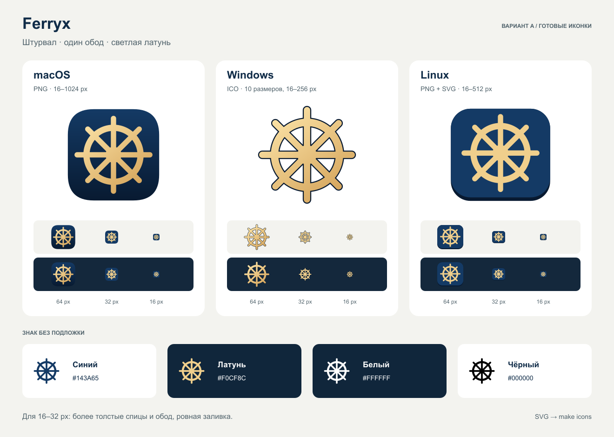

# Ferryx app icon

The approved direction A keeps the helm: one rim, eight rounded spokes and a
solid hub, in light brass and deep blue. The SVG files here are the editable
masters. All artwork uses filled vector shapes, with transparent openings and
no fonts, raster images or filters.



## Masters and generated assets

| Use | Master | Generated sizes (physical pixels) |
| --- | --- | --- |
| macOS asset catalog | `ferryx-macos.svg` | 64, 128, 256, 512, 1024 |
| Small macOS icon | `ferryx-macos-small.svg` | 16, 32 |
| Windows transparent icon | `ferryx-windows.svg` | 40, 48, 64, 96, 128, 256 |
| Small Windows icon | `ferryx-windows-small.svg` | 16, 20, 24, 32 |
| Linux hicolor icon | `ferryx-gnome.svg` | 48, 64, 128, 256, 512, plus scalable SVG |
| Small Linux icon | `ferryx-gnome-small.svg` | 16, 24, 32 |
| Desktop symbolic icon | `ferryx-symbolic.svg` | SVG on a 16 px grid, recoloured by the desktop |
| Standalone mark | `ferryx-symbol.svg` | Navy SVG on a 256 px grid |
| One-colour marks | `variants/ferryx-symbol-{black,brass,white}.svg` | SVG on a 256 px grid |

The small drawings use heavier spokes and rims, and flat colour. Choose the
drawing by output pixel size, not the display's logical point size. Do not
derive 16–32 px icons from the large PNGs. The white standalone mark is slightly
thinner to balance its appearance on a dark background.

The platform adaptations retain the same eight-spoke silhouette:

- macOS: brass shading on a navy tile, using the project's PNG asset catalog.
- Windows: a transparent object with a navy edge to keep the brass visible on
  light backgrounds; the ICO contains all ten resolutions.
- Linux: flat colours, a front-facing tile with a small lower lip, and a
  separate single-colour symbolic icon.

Platform references: [Apple app icons](https://developer.apple.com/design/human-interface-guidelines/app-icons),
[Windows icon construction](https://learn.microsoft.com/en-us/windows/apps/design/iconography/app-icon-construction)
and [GNOME app icons](https://developer.gnome.org/hig/guidelines/app-icons).

## Palette and placement

| Colour | HEX | RGB | Use |
| --- | --- | --- | --- |
| Navy | `#143A65` | 20, 58, 101 | Tile; standalone mark on light backgrounds |
| Midnight | `#081A31` | 8, 26, 49 | Gradient base; Windows edge; Linux lower lip |
| Brass | `#F0CF8C` | 240, 207, 140 | Flat helm and small icons; mark on dark backgrounds |
| Brass highlight | `#FFE9AE` | 255, 233, 174 | Large macOS/Windows gradient start |
| Brass shade | `#D2A056` | 210, 160, 86 | Large macOS/Windows gradient end |
| Black / white | `#000000` / `#FFFFFF` | 0, 0, 0 / 255, 255, 255 | One-colour reproduction |

Keep the standalone mark at least 32 px wide. For a monochrome 16 px context,
use `ferryx-symbolic.svg`. Preserve the transparent padding of the masters.
For a cropped standalone mark, leave at least one spoke width of clear space
(12 units on the 256-unit grid) between its outer tips and other content.

Use navy or black on light backgrounds, and brass or white on dark backgrounds.
Keep the mark upright and square. Do not stretch it, change the spoke count,
close the openings, add text inside the tile or add effects to the small icons.

## Rebuild

Install `rsvg-convert` from librsvg (`brew install librsvg` on macOS or
`apt install librsvg2-bin` on Debian/Ubuntu), then run from the project root:

```sh
make icons
```

The dependency-free Python script renders PNGs and packs the Windows ICO. It
writes the macOS `AppIcon.appiconset`, Windows `app_icon.ico`, Linux hicolor
tree, and `brand/ferryx-256.png`. The last file is shared by the README and the
Flutter app's identity UI through its existing asset declaration. Native
resource names and asset paths stay stable. Rebuild the app to include the new
resources; do not edit generated PNGs or the ICO directly.

The presentation is a static snapshot of the approved artwork. Its labels are
live text; use the individual SVG masters for app resources. To render it:

```sh
rsvg-convert brand/ferryx-icons-preview.svg -o brand/ferryx-icons-preview.png
```

Exploration and the original comparison remain in
[`proposals/2026-11-08/`](proposals/2026-11-08/). They are design history, not
production sources.
